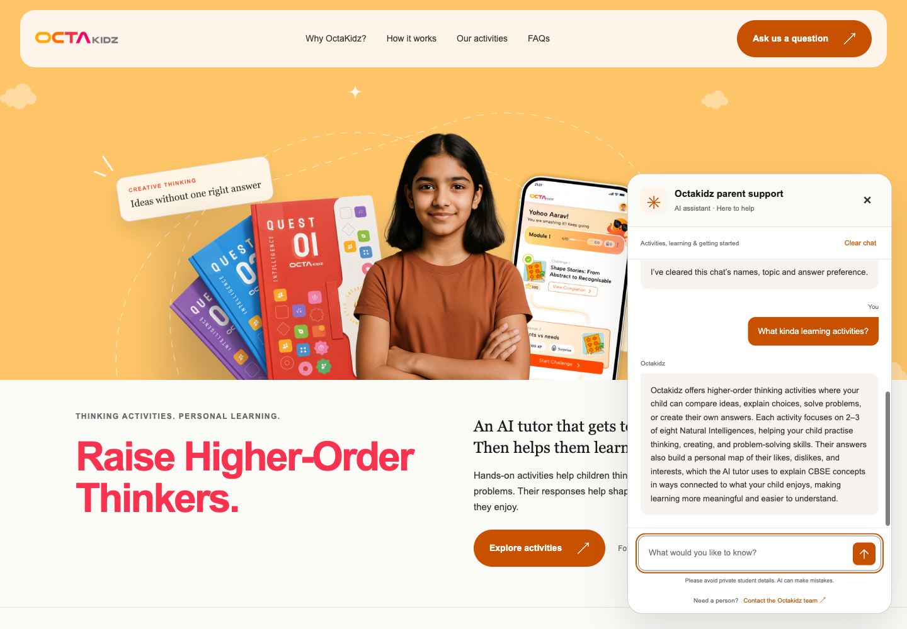
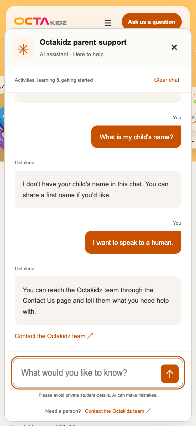

# Parent support agent - independent capstone

Python, LangChain and OpenAI support assistant for parents exploring Octakidz. It explains approved public product facts, searches by meaning, uses two bounded tools, remembers limited context during a chat, adapts answer length and offers human-contact guidance. Scenario 3: Customer Support; Track A: LangChain.

This repository contains the independently built capstone agent. Private Octakidz tutor/business code and the homepage/server implementation are excluded. The optional UI is documented through eight selected screenshots: two historical, four current local and two hosted. No credentials or environment files are supplied.

## Demonstration links and screenshots

[All submission links](SUBMISSION_LINKS.md) · [Hosted preview](https://octakidz-parent-support-demo-2om0ih0ue-rajeshm006s-projects.vercel.app) · [Recorded hosted demonstration](docs/HOSTED_DEMO.md) · [Actual same-question comparison](docs/HOSTING_TEST_RESULTS.md).

**The hosted preview requires Vercel sign-in with an authorised account.** Reviewers can use the included actual screenshots/replies and run the independent terminal agent below; assessment does not depend on private preview access. The hosted server passed eleven unchanged fixed questions plus eight fictional context turns. Its separate private workspace suite passed 192 offline tests; this source-only package retains the 159 core tests. Action/render agreement on known cases is not a general accuracy score.


## Run locally

Use Python 3.10+ (verified on macOS arm64, Python 3.14.4). Create an environment and install exact pins:

```sh
python3 -m venv .venv
.venv/bin/python -m pip install -r requirements.lock.txt
```

Set `OPENAI_API_KEY` privately in your own environment or an untracked local `.env`. The optional `OPENAI_MODEL` defaults to `gpt-4.1-mini`. Never paste a real key into source, chat, a notebook or Git. No example environment file is included. A paid/quota-enabled OpenAI API account and network access are needed for real model calls.

```sh
python3 run_chat.py --check
python3 run_chat.py
```

The check makes no API requests. A missing local index is expected in a clean checkout: the first permitted search embeds the 30 public FAQ entries and creates an ignored cache. Do not copy a credential or cache from someone else's computer. An invalid/stale cache requires an explicit rebuild using `semantic_search.py --rebuild`.

Use `/short`, `/normal`, `/reset` and `exit`. `--debug` shows public tool/source stages and safe counters. Type support questions, never shell commands, at the chatbot prompt. The assistant cannot execute code, access student accounts, send email or make an actual human transfer.

```sh
.venv/bin/python -m unittest discover -s tests
.venv/bin/python verify_saved_evaluation.py
.venv/bin/python demo_submission.py --output-dir demo_run
```

Tests and saved-result scoring make no API calls. The last command runs five authored demo scenarios against OpenAI and preserves actual replies in a new folder. It must not overwrite existing evidence. Demo names are fictional; never substitute real student records. Temporary chat memory uses first names, up to three public topic IDs and a style flag, with reset and 600-second lazy expiry; it is separate from the product's private personal map. Metadata-only local logs are ignored by Git.

Public repository: [Rajeshm006/octakidz-parent-support-capstone](https://github.com/Rajeshm006/octakidz-parent-support-capstone). Submit the separately named course ZIP; the link is an additional reference.

## Run the existing private UI and understand hosting

From the owner's existing private capstone folder containing `web/index.html`, `web/chat.js` and `web_server.py`:

```sh
python3 web_server.py --check
python3 web_server.py --port 8771
```

Open **http://127.0.0.1:8771** and choose **Ask Octakidz**. Stop with Ctrl+C. This is a local address on the owner's computer, not a public demo link. These UI commands require the separate private UI folder; a clone of this public repository runs the independent terminal agent using the instructions above.

Opening `index.html` directly does not start the Python chat backend. The separate [protected hosted preview](docs/HOSTED_DEMO.md) now serves the selected frontend and Python API together, with Redis temporary state and server-only credentials. Its UI/hosting source remains outside this public checkout. [Vercel hosting notes](docs/VERCEL_HOSTING.md) explain that boundary.

Fresh Playwright verification uses the current backend: **11 fixed questions + eight fictional conversation turns**, all expected actions and all displayed replies matched. Normal/short map explanation: **72 to 53 words**. No observed browser errors; mobile layout, Clear chat, private-route refusals and human guidance passed these checks. These are authored flow tests, not a general accuracy score. [Actual test report](docs/UI_BROWSER_TEST.md).





## Submission documents

- [Problem framing, two-page PDF](docs/PROBLEM_FRAMING.pdf)
- [Five forced demo scenarios](docs/DEMO_SCRIPT.md) and [actual final demo](evidence/final_demo/RESULTS.md)
- [Evaluation report](docs/EVALUATION_REPORT.md), [every current reviewed reply](docs/QUALITY_REPLIES.md) and [same-test-set prompt comparison](docs/PROMPT_COMPARISON.md)
- [Engineering and product justification](docs/ENGINEERING_PRODUCT_JUSTIFICATION.md)
- [UI demonstration record](docs/ui/README.md)
- [Hosted demo, screenshots and access note](docs/HOSTED_DEMO.md), [actual same-question results](docs/HOSTING_TEST_RESULTS.md) and [submission links](SUBMISSION_LINKS.md)
- [Publication scope and exclusions](docs/PUBLICATION_SCOPE.md), [package verification](docs/PACKAGE_VERIFICATION.md) and [file manifest](FILE_MANIFEST.json)

The recorded 45-reply audit scores 10/10 supported, 5/5 missing-information and 5/5 safety cases against the fixed checklist. These known, assistant-reviewed cases meet draft checks; they are not population accuracy, independent expert validation, a grade or production certification. The final package has separate smoke/demo checks. Two historical browser screenshots retain their older backend label; the four new screenshots and current browser results use phase9_answer_quality_v1.

The assignment permits local deployment. The optional hosted demonstration is a separate protected preview, not a public business launch; it is documented here without shipping its UI/server source or credentials. Provider keys remain server-side and are never public browser variables. This repository grants no licence to proprietary Octakidz assets or code; the selected illustrative screenshots are demonstration evidence only.
