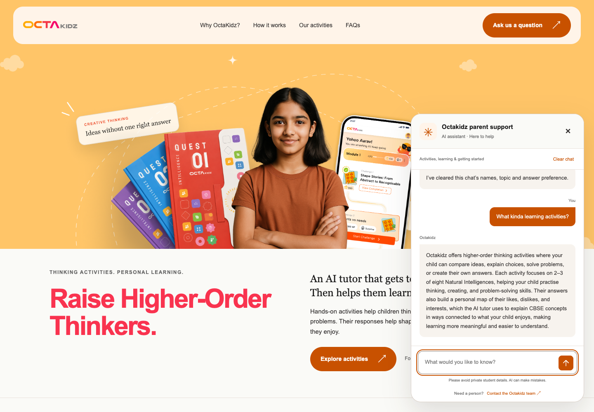
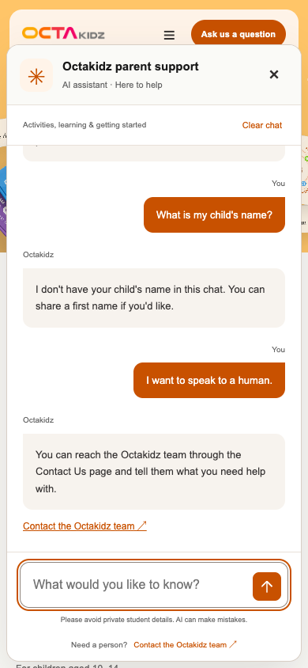

# Hosted Octakidz parent-support demonstration

Verified 27 October 2026. [Hosted preview](https://octakidz-parent-support-demo-2om0ih0ue-rajeshm006s-projects.vercel.app) · [Public independent source](https://github.com/Rajeshm006/octakidz-parent-support-capstone) · [All submission links](../SUBMISSION_LINKS.md).

**The hosted preview is protected by Vercel Authentication.** It requires an authorised account and is not promised to be accessible to the course reviewer. Use the screenshots, actual replies and runnable terminal agent in this package if access is unavailable. No public-access change or production launch is claimed.

## What is running

The homepage connects to a private FastAPI server, the existing Python/LangChain support agent and OpenAI. Redis shares minimal temporary chat context across requests: recognised parent/child first names, at most three public support topic IDs, a short/normal preference and a turn count. The server assigns a 600-second idle TTL; reset deletes that context. No transcript, ages, interests or real student records are stored by this adapter. This temporary support memory is separate from the product's private personal-map/tutor implementation, which is not included or accessed.

The approved public FAQ/index is read-only. The OpenAI key is a server-only preview Secret; Redis credentials also stay server-side. The browser receives an opaque Secure/HttpOnly/SameSite Strict cookie, never a provider key. Request boundaries enforce exact allowed origins, bounded JSON and an explicit static selection. Demo limits are twelve chat attempts per minute and one hundred per day globally, sixty turns per session, one active request per session and two concurrent turns overall. Contact guidance does not send an email or perform a transfer.

## Actual checks

| Evidence | Observed result |
| --- | --- |
| Independent packaged terminal agent | 159 core tests; its source, prompts, knowledge facts and pins remain unchanged. |
| Private workspace/server offline suite | 192 tests pass, including nineteen new fake-agent/Redis-Lua boundary tests. [Recorded output](../evidence/hosted_demo/offline_tests.txt). Hosting/UI test source remains private. |
| Local hosting adapter browser run | Eleven fixed questions and eight fictional context turns agree with expected actions/statuses/displayed answers; recorded separately from the online run. |
| Actual Vercel + Redis browser run | Eleven unchanged fixed questions plus eight fictional context turns, all HTTP 200 with expected action and exact displayed reply agreement. [Actual results](../evidence/hosted_demo/results.json). |
| Feedback and memory | Warm introduction, recognised name recall, supported follow-up and reset behave as expected. Normal/short map explanation is 80→53 words. |
| Hosted HTTP/privacy boundaries | Four environment/source/index/provenance paths return 404. Secure cookie flags, empty local/session storage and mobile bounds pass. No browser page error was recorded. |
| Cloud selection | Thirty-seven remote source files match the reviewed private selection, with no unexpected files or hash mismatches; Vercel omits the local .gitignore. Environment files and actual key values are absent from the selected files. |

These checks establish the tested browser→API→Redis/public FAQ→OpenAI→display path. Action/render agreement is not factual accuracy. No fresh forty-five-case score, forced multi-worker test, full ten-minute live expiry, live budget exhaustion/outage test, production certification or grade guarantee is claimed. Shared-state/TTL/limits/error behaviour has separate emulator tests. Name parsing/redaction is heuristic and model wording varies.

Two unusable setup deployments were removed after the working preview passed. An initial packaging/import issue, a fixture mismatch, provider-added guides, premature upload after a failed selection check, dependency precedence and a nested-file filter error are preserved in the [verification summary](../evidence/hosted_demo/verification_summary.json). Only the final working preview is counted as successful.

## Hosted desktop activities reply

Actual browser screenshot from hosted_chat_v1 with backend phase9_answer_quality_v1. It explains both activity purposes and the intelligence count.

## Hosted mobile support

Actual 390×844 browser screenshot after reset: the child's name is no longer recalled, and the parent can open configured human-contact guidance.

The screenshots are demonstration evidence, not UI implementation assets. Browser-delivered HTML/CSS/JavaScript can be inspected by visitors, even when its repository is private. UI/server source, original tutor/business code, raw branding, environment files, secrets and authentication state are intentionally excluded from this submission. [Same-question comparison](HOSTING_TEST_RESULTS.md) · [Full image record](ui/README.md).
