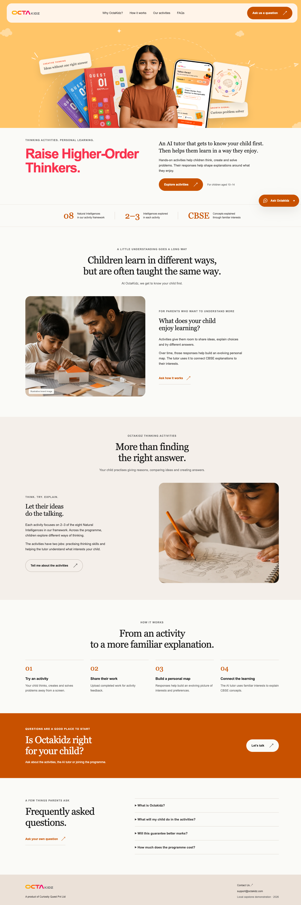
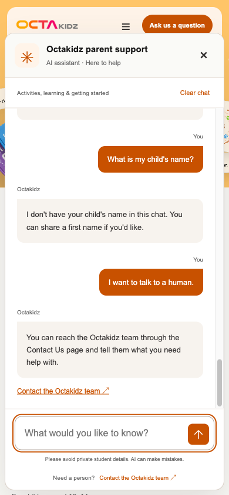

# Octakidz parent support interface

Documentation date: 27 October 2026. Interface version: **homepage_chat_v1**. This record describes a local homepage and support-chat demonstration. It shares the parent experience through documentation and screenshots, without sharing the UI implementation or private product code.

## Purpose

The interface helps parents of children aged 10–14 understand the thinking activities, the evolving personal map and the hyperpersonalised AI tutor. It gives parents a place to ask questions while exploring the programme and a route to the team when they need confirmed details or human help.

The homepage explains two activity purposes: practising thinking skills through 2–3 of eight Natural Intelligences per activity, and building an evolving interest map that guides familiar CBSE explanations. The support demonstration describes that journey. It does not implement or access the private academic tutor, student maps, uploads, accounts, enrolment or payments.

## What the parent can do

| Part of the interface | Parent experience |
| --- | --- |
| Homepage | Read the introduction, activities, four-step learning journey and public questions. Navigation moves between sections on one page. |
| Chat entry points | Open the panel using Ask Octakidz or the page's question buttons. Suggested questions help a new parent begin. |
| Questions and replies | Type a question, send with the button or Enter, see a loading message and read a plain-text reply. Input is disabled while a reply is pending. |
| Conversation | Use recognised first-name introductions and follow up on the previous public support topic. The chat does not retrieve a real child's profile. |
| Short answers | Ask for shorter answers or use `/short`; `/normal` restores the usual level of detail. Important facts and qualifications take priority over a strict word limit. |
| Clear chat | Clear the visible messages and the assistant's temporary names, topic and answer-length preference. |
| Human help | Open the configured Contact Us page. A contact link is guidance; the bot does not send a message or perform a transfer. |
| Mobile and keyboard | Use the responsive chat panel, keyboard input, focus handling and Escape to close. Errors are displayed in the panel so the parent can retry. |

## How the UI connects to the agent

The parent types into the browser. A local Python service receives the question and passes it to the independent support agent. The agent checks the request, searches approved public support content when needed, checks supporting sources and returns an answer or controlled guidance. The browser then displays the reply.

The UI is a way to use the support agent; it adds no private tutor access, new product facts or extra model capability. The OpenAI credential is read by Python on the owner's computer. It is not supplied to the browser, embedded in a page or placed in the screenshot/documentation bundle.

## Temporary data and privacy

- Each browser session uses a random session cookie. Independent browser contexts receive separate agent state; tabs within one context share the cookie.
- The assistant temporarily retains recognised first names, up to three public topic identifiers and an answer-length preference. It does not retain a full conversation transcript in its memory.
- Messages are visible on the page while chatting. The interface does not save them to localStorage, sessionStorage or a database. Refresh can clear visible messages while an unexpired session still exists; use Clear chat to clear both.
- After ten idle minutes, the interface clears visible messages and requests a reset. Python also expires unused state before reuse. Background-tab timing and restored browser-session cookies have limits; closing a tab alone is not a reliable deletion action.
- The browser requests support replies from the local service. Python sends permitted, minimised support content to OpenAI when a model/search request is needed. This is not an offline AI or a promise about provider retention.
- The server serves the dedicated static UI folder, rather than the project directory. Requests for the root `.env`, Python source and operational logs are rejected by the tested routes. Parent/model strings are displayed as plain text, with no HTML execution.
- No production authentication, private-record access or public internet deployment is claimed. The local demo listens on loopback only.

## Screenshots

These are actual screenshots from the **26 October 2026 browser run**, whose answer backend was frozen at **phase9_completeness_v2**. They illustrate the interface, not a fresh test of later backend answers. The files were selected individually; no implementation snapshots or complete evidence directories accompany them.

### Desktop homepage

### Mobile support chat

The mobile capture shows that a cleared chat does not claim to remember a child's name, followed by a request for human help and the configured contact link. It does not show an actual student record.

## What has been checked

| Evidence | Version and observed result | What it establishes |
| --- | --- | --- |
| Historical real browser run, 26 October | UI `homepage_chat_v1`, backend `phase9_completeness_v2`: eleven fixed questions and ten fictional context turns had matching expected actions and rendered replies. Desktop/mobile, reset, isolation, keyboard and clearly labelled simulated error/render/expiry checks were recorded. | The recorded browser flow worked in that local run; action/render agreement is not answer accuracy. |
| Current UI identity, 27 October | All nine tracked interface/fixture files match their recorded final UI hashes. | The documented interface files match that final interface record. Earlier screenshots still retain their original backend/version and final-preview caveats. |
| Fresh offline interface checks, 27 October | All **14 existing interface tests pass**, including session isolation/reset, blocked environment/source paths, request validation and safe error handling. They use fake answers or local rules, with no OpenAI requests. | Current local HTTP/session boundaries pass these checks; this is not a new live-browser or general privacy certification. |
| Checked startup, 27 October | Required local packages, support files and UI files pass readiness checks without API requests. | The local setup is ready to attempt a chat; the check does not validate online quota or API-key acceptance. |
| Separate current answer-quality audit | Backend `phase9_answer_quality_v1`: 10/10 supported, 5/5 missing-information and 5/5 safety cases met the assistant-reviewed checklist. | Known Python-agent development cases meet the draft checks. They must not be relabelled as new browser results or a course grade. |

The earlier browser run included a science-coverage wording concern; the later backend audit records its own repair and limitations. Model variability, imperfect name recognition, soft answer-length targets and broader parent/owner validation remain relevant. The interface is a local demonstration, not a complete business product or a claim of improved child learning outcomes.

## Submission boundary

This UI portion contains **only this document and two screenshots**. The UI source, raw brand assets, original business code, environment files and credentials remain outside it. The capstone's independent working-agent submission is a separate selection. The dedicated demonstration and package checks are documented in the main submission reports.
